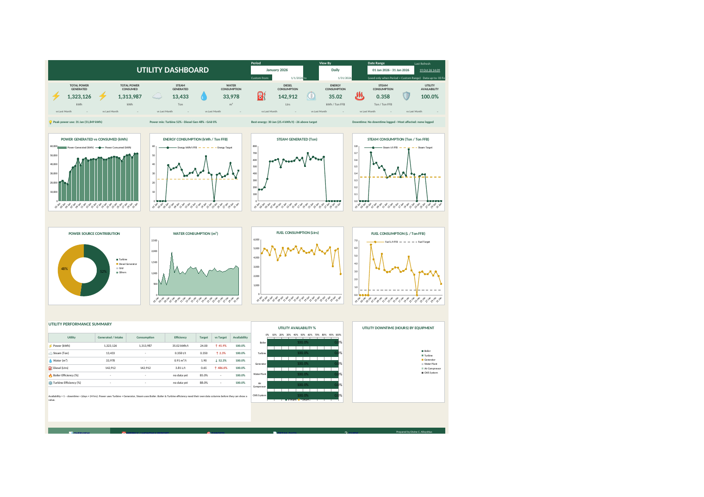
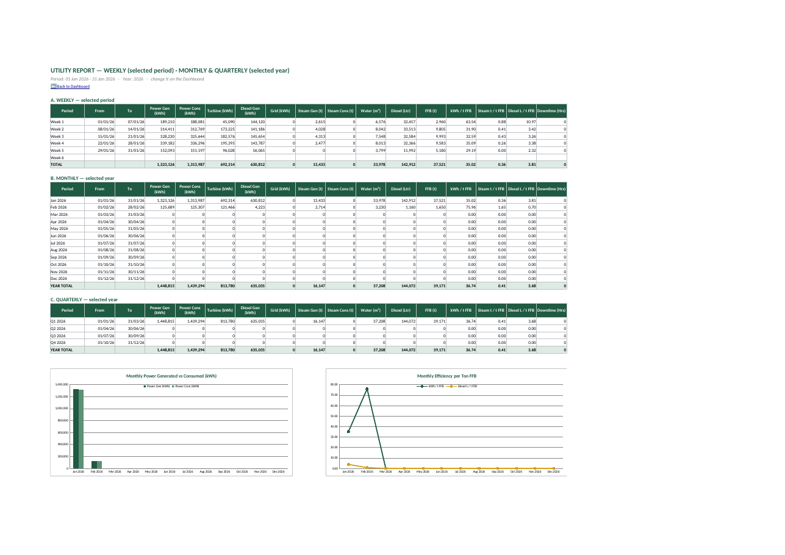

# Utility Dashboard — Palm Oil Mill (Build in Progress)

**Author:** Divine C. Alloyshius, Manufacturing & Business Analyst · Presco Plc
**Category:** Utility Analytics · Energy & Resource Efficiency · Downtime & Availability
**Tools:** Microsoft Excel 2019 (no VBA, no add-ins), company production server
**Status:** 🚧 In build. Layout, engine and reports complete; live data linking in progress.

## Overview

The utility section keeps the whole mill running: **power** (steam turbine, diesel generators, grid), **steam** (Vickers and Atmindo boilers), **water**, **diesel**, **compressed air** and the **cooling water system (CWS)**. Before this project, there was no single view of how much of each utility we generate, how much we use per ton of fresh fruit bunches (FFB) processed, or how often the equipment goes down.

This dashboard puts all of it on one page, compared with targets and with the previous period, and updates automatically when new daily data is added.

## The business problem

| Before | Impact |
|---|---|
| Utility figures stored in separate Excel files, one folder per system | No combined picture of power, steam, water and fuel together |
| Steam from two boilers recorded in separate rows | Total steam generated had to be added up by hand |
| No efficiency ratios (per ton FFB) | Hard to tell if usage was rising because of more production or more waste |
| No downtime record for utility equipment | Breakdowns, causes and availability were not measured at all |

## What the dashboard shows

**8 KPI cards**, each with a comparison against the previous period:
Total Power Generated · Total Power Consumed · Steam Generated · Water Consumption · Diesel Consumption · Energy Consumption (kWh / ton FFB) · Steam Consumption (ton / ton FFB) · Utility Availability %

**Auto insights line:** peak power day, power mix (turbine vs diesel vs grid), best energy-efficiency day, and the equipment with the most downtime.

**8 trend charts:** Power Generated vs Consumed, Energy per ton FFB vs target, Steam Generated, Steam per ton FFB vs target, Power Source Contribution, Water Consumption, Fuel Consumption, and Fuel per ton FFB vs target.

**Performance summary table:** generated, consumed, efficiency, target, % vs target and availability for every utility.

**Availability and downtime:** availability % per equipment item (boiler, turbine, generator, water plant, air compressor, CWS) and downtime hours by equipment.

**Weekly / Monthly / Quarterly report sheet:** all totals and ratios rolled up automatically.

## How it is built (Excel 2019, fully automatic)

| Layer | What it does |
|---|---|
| **ALL DATA** | One long, tidy source table: one row per day, one column per measure. Every report reads from here. |
| **Lists** | Period choices: *Latest Month (auto)*, *Custom Range*, or any month from Jan 2025 to Dec 2030. View by Daily / Weekly / Monthly. |
| **Targets** | A lookup table for kWh/t, steam t/t, water m³/t, diesel L/t, boiler & turbine efficiency and availability. Change a target once and everything updates. |
| **Calc** | The engine: SUMIFS / COUNTIFS for the selected period, the same number of days in the previous period for fair comparison, and dynamic named ranges (OFFSET) so the charts grow and shrink with the period. |
| **Dashboard** | Pure presentation. No hard-typed numbers. |

Design choices:
- **No VBA and no Excel 365 functions.** Works on the Excel 2019 installed across the company.
- **Fair comparisons.** If the current month has 12 days of data, it is compared against the first 12 days of last month, not the full month.
- **Company colours.** Forest green, ivory and grey taken from Presco's colour code. Red is used only for "worse than target", so problems stand out.

## Companion tool: Utility Downtime Tracker

While building this, I found the utility section had **no file for recording equipment downtime**. I built one:

- **Daily log:** date, shift, section, equipment (dropdown that depends on the section), cause, reason, start/end time (duration calculated), action taken, reported by.
- **Reports:** weekly, monthly and quarterly downtime by section, equipment and cause; planned vs unplanned; availability %.
- **Year overview:** every week, month and quarter on one sheet.

It feeds the availability and downtime sections of this dashboard.

## Data quality findings so far

Building the dashboard exposed gaps in the source data. That is part of the value:
- Days where FFB was processed but steam generated was recorded as 0
- Downtime columns not yet being filled, so availability shows 100%
- No fields yet for fibre/shell fed to the boilers, which are needed to calculate boiler efficiency

## Roadmap

- [x] Data checklist from the mockup
- [x] Source table structure and calculation engine
- [x] Dashboard layout, 8 KPIs, 10 charts, summary table
- [x] Weekly / Monthly / Quarterly report
- [x] Downtime Tracker for the utility section
- [x] Presco colour palette
- [ ] Link live utility data from the production server
- [ ] Validate figures against source records
- [ ] Official targets from management
- [ ] Boiler and turbine efficiency (new data fields)
- [ ] Hand-over and review with the Utility supervisor

See [the build log](05-utility-dashboard-build-log.md) for the day-by-day log.

## Skills demonstrated

Excel 2019 · Data modelling (tidy source tables) · Dynamic named ranges · KPI and target design · Energy & utility analytics · Downtime / availability analysis · Dashboard design · Stakeholder-driven requirements
