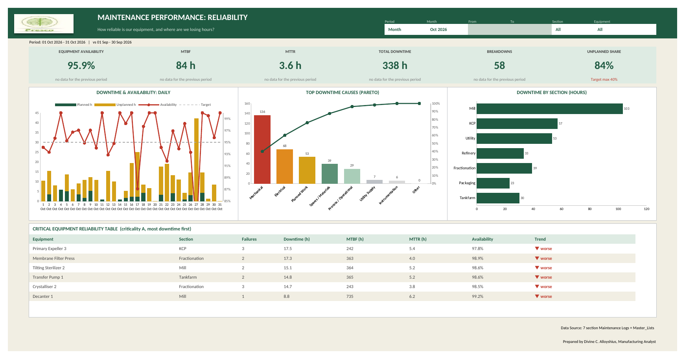
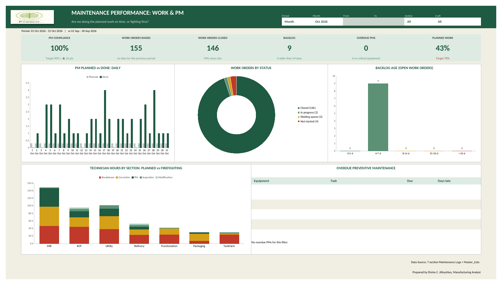
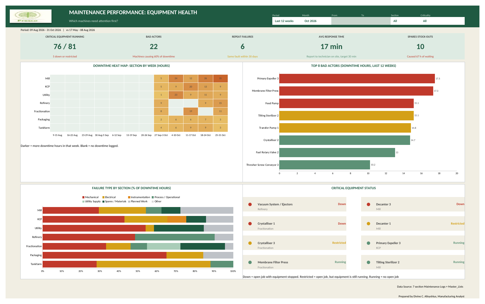

# Maintenance Logs and Maintenance Performance Dashboard

**Author:** Divine C. Alloyshius, Manufacturing Analyst · Presco Plc
**Contact:** divine.alloyshius@siat-group.com · +234 814 760 3384
**Category:** Maintenance & Reliability Analytics · Asset Management · Work Management
**Tools:** Microsoft Excel 2019 (no VBA, no add-ins, no Excel 365 functions)
**Status:** Built and sent to management for review (Nov 2026). Running on one month of test data until approval.

*Reliability page, shown with October 2026 test data (not real results).*

## Overview

Maintenance is where a lot of factory knowledge gets lost. Job cards exist, but not every job done across all sections is logged, or the job card followed through to the end. Without a complete record, nobody can say with confidence which machines fail most, how long repairs take, or how much of the team's time goes on planned work versus firefighting.

I built a maintenance system in two parts:

1. **Seven section Maintenance Logs** (Mill, KCP, Utility, Refinery, Fractionation, Packaging, Tankfarm), all fed by **one Master List** of equipment, technicians, failure types and causes.
2. **One Maintenance Performance Dashboard** that reads all seven logs and turns every job into reliability, work and equipment-health figures for management.

## The business problem

| Before | Impact |
|---|---|
| Not every maintenance job recorded, job cards not always closed | No reliable history per machine |
| Equipment registered in groups, e.g. "Ramp Gates (16)" | Impossible to tell which of the 16 units keeps failing |
| No common list of failure types and causes | The same fault written five different ways, so nothing can be counted |
| No measure of planned vs emergency work | No way to show whether preventive maintenance is working |
| Each section kept its own records, in its own way | No factory-wide view of maintenance performance |

## The solution

### 1. Master Lists (one source of truth)

- **Equipment register per section** with an Equipment ID for every single unit. Grouped items were split into numbered units, e.g. Ramp Gate 1 to Ramp Gate 16, each with its own ID.
- **Criticality** A / B / C for every machine (A = stops production). 81 machines are marked A.
- **Technicians** with craft (mechanical, electrical, instrumentation).
- **Failure types and causes** (8 types, up to 15 causes each). The Cause dropdown in the logs follows the Failure Type chosen.
- **PM schedule** with tasks and frequencies.

Equipment for Mill and KCP comes from the maintenance department's equipment monogram. Utility, Refinery, Fractionation, Tankfarm and Packaging use starter lists while the official monogram is being completed.

### 2. Section Maintenance Logs (one per section)

One row per job, with 3,000 ready rows per section. Type in white cells, pick from green dropdowns, grey columns fill themselves.

| Entered by the user | Calculated automatically |
|---|---|
| Date and time reported, shift (Day / Night), station, equipment, job type, failure type, cause, fault description, priority, equipment stopped?, technicians, arrival time, completion date and time, work done, spares used, status | Job No, Equipment ID, criticality, craft, response time (min), repair time (h), downtime (h), repeat failure within 30 days, data check (flags missing or wrong entries) |

Dropdowns read live from the Master List, so a new machine added once appears in every log.

### 3. Maintenance Performance Dashboard

Three dashboard pages, a printable section report and a settings sheet.

| Page | Question it answers | What it shows |
|---|---|---|
| **Reliability** | How reliable is our equipment, and where are we losing hours? | Equipment availability, MTBF, MTTR, total downtime, breakdowns, unplanned share; daily downtime and availability trend; Pareto of causes; downtime by section; critical equipment reliability table |
| **Work & PM** | Are we doing planned work on time, or fighting fires? | PM compliance, work orders raised and closed, backlog, overdue PMs, planned work %; PM planned vs done; work orders by status; backlog age; technician hours by section, planned vs firefighting |
| **Equipment Health** | Which machines need attention first? | Critical equipment running, bad actors, repeat failures, average response time, spares stock-outs; downtime heat map by section and week; top 8 bad actors; failure type by section; critical equipment status |
| **Report** | One page per section for the section manager | Key figures, downtime by station, top 10 equipment, technician work done, overdue PMs, open jobs |

**Filters:** Period (Month, Weekly, Quarter, Year, Last 4 weeks, Last 12 weeks, Last 6 months, Custom), Month, From/To dates, Section, and Equipment / Craft / Criticality.

**Trends adapt to the period.** Month shows each day, Weekly shows the weeks of the month, Last 4 or 12 weeks show weekly totals, Year and Last 6 months show monthly totals.

## How the key figures are worked out (plain words)

| Figure | Meaning | Example |
|---|---|---|
| **MTBF** (mean time between failures) | Average running hours between breakdowns | 4,872 running hours / 58 breakdowns = 84 h |
| **MTTR** (mean time to repair) | Average repair time per breakdown | 209 repair hours / 58 breakdowns = 3.6 h |
| **Availability** | MTBF / (MTBF + MTTR) | 84 / (84 + 3.6) = 95.9% |
| **Planned work %** | PM, inspection and modification jobs as a share of all jobs | 67 of 155 jobs = 43% |
| **PM compliance** | PMs done / PMs due from the PM schedule | 18 of 20 = 90% |

## Challenges and how they were solved

| Challenge | Solution |
|---|---|
| Must run on **Excel 2019** with **no macros** (company standard) | Built only with SUMIFS, COUNTIFS, SUMPRODUCT, INDEX/MATCH and OFFSET. No XLOOKUP, FILTER or dynamic arrays. |
| The dashboard must read **seven closed log files** | External links to each log, with the calculated columns included in the link cache, so figures show correctly even when the logs are closed. |
| Grouped equipment hid which unit failed | Split every grouped item into numbered units with their own IDs. |
| **Cost and budget data not available** to the analyst | Replaced the cost panel with something every manager can act on: **planned work %** and **technician hours by section, planned vs firefighting**. |
| MTBF showed a misleading drop of 4,956 h when the previous month had no data | Comparisons now say "no data for the previous period" or "no failures in the previous period" instead of comparing with an empty month. |
| Dashboards looked wrong on different screen sizes | Fixed print area plus a one-step "Zoom to Selection" so it fits any screen, without macros. |
| Logs needed to be easy for technicians, not just analysts | Colour code (white = type, green = pick, grey = automatic), date and time checks, and a Data Check column that tells the user what is missing. |
| Testing before real data exists | Loaded one month of realistic test data (147 jobs across 7 sections) and checked every figure against an independent calculation. |

## Results (October 2026 test data)

| Figure | Result |
|---|---|
| Equipment availability | 95.9% |
| MTBF / MTTR | 84 h / 3.6 h |
| Breakdowns | 58 |
| Work orders | 155 raised |
| Planned work | 43% |
| Critical equipment running | 76 of 81 |

These are test figures used to prove the dashboard. Real figures start when live logging begins.

## Benefits and use cases

- **Plant and maintenance managers:** see which machines fail most and why, and decide where to spend effort and spares.
- **Supervisors and technical officers:** a section report showing their open jobs, overdue PMs and repeat failures.
- **Planning:** track whether preventive maintenance is reducing breakdowns over time.
- **Management:** one view of maintenance across all seven sections, with no manual compiling.
- **Data discipline:** every job is logged the same way in every section, so the record can be trusted.

## Roadmap

- [x] Master Lists, 7 section logs, dashboard (3 pages), section report
- [x] Period filters with adaptive trends
- [x] Planned vs firefighting view in place of cost
- [x] Test month loaded and verified
- [x] Sent to management for review (Nov 2026)
- [ ] Official equipment monogram for Utility, Refinery, Fractionation, Tankfarm, Packaging
- [ ] Confirm criticality and PM tasks with the maintenance manager
- [ ] Remove test data, train users, start live logging

## Skills demonstrated

Maintenance and reliability KPIs (MTBF, MTTR, availability, PM compliance) · Data model design across linked workbooks · Excel 2019 without macros · Dashboard design · Data validation and data quality checks · Stakeholder-driven requirements
