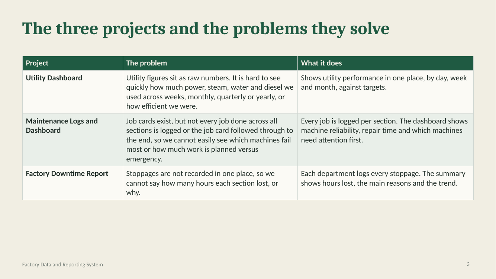

# Factory Data and Reporting System (Overview)

**Author:** Divine C. Alloyshius, Manufacturing Analyst · Presco Plc
**Contact:** divine.alloyshius@siat-group.com · +234 814 760 3384
**Status:** Phase 1 (Utility, Maintenance, Factory Downtime) in daily use; presented to management for feedback, November 2026.



## Why this started

I joined the production team in October 2024, in charge of production reporting. I quickly saw that the factory produces a lot of data every day, but much of it is not properly recorded or put to full use. With a one-year diploma in Data Analysis behind me, I set myself one goal:

> **No data in the factory should go unrecorded or unused.**

Every section, from the Mill and KCP to Utility, Refinery, Fractionation, Tankfarm, Packaging and Maintenance, should record its data in one structured way, and that data should become reports that executives, managers, supervisors and technical officers can use to make decisions.

## How the pieces fit together

```
Master Lists (equipment, technicians, causes)
        │
        ├──► 7 section Maintenance Logs ──► Maintenance Performance Dashboard
        │              ▲ job number
        └──► Factory Downtime Report (5 departments)
                       │ utility downtime (boiler overlap rule)
                       ▼
Daily utilities entry ──► Utility Dashboard + Weekly / Monthly / Quarterly report
```

| Project | Case study |
|---|---|
| Utility Dashboard | [05-utility-dashboard.md](05-utility-dashboard.md) |
| Maintenance Logs and Dashboard | [06-maintenance-system.md](06-maintenance-system.md) |
| Factory Downtime Report | [07-factory-downtime-report.md](07-factory-downtime-report.md) |

## What the factory gains

| Benefit | How |
|---|---|
| More output | Less downtime means more FFB and CPO processed |
| Lower utility cost | Power, steam and diesel use watched against targets, so waste shows up quickly |
| Fewer repeat breakdowns | We see which machines fail most and fix the root cause |
| Time saved | No manual compiling; reports are ready daily, not put together at month end |
| Clear ownership | Every KPI has an owner, so problems are fixed by the people closest to them |

## Presenting it to management

In November 2026 I sent a 15-slide presentation and the files to management for their feedback on any changes needed. The deck covers the goal, the three projects, what the factory gains, where the data stands, why putting data to use matters, the role of a Manufacturing Analyst, the planned summary report, shared ownership, what comes next and what still needs to be in place.

Lessons from preparing it:

- **Lead with the problem, then the benefit.** Managers respond to "more output, less waste, faster fixes" more than to a list of features.
- **Be honest about status.** Test data is labelled as test data. Equipment lists still being completed are shown as "in progress", not "done".
- **Plain words win.** Every slide was rewritten until a busy manager could read it at a glance.

## Coming next

- **Factory Summary Report** (in progress): one daily, weekly and monthly email covering every section: what was achieved, work done, challenges, and KPIs against targets, with a named owner for each KPI. The aim is shared ownership, so results are not the line manager's responsibility alone.
- **Updated Mill Performance Dashboard:** everything that happens across the mill.
- **Updated Refinery Performance Dashboard:** the refinery plus Fractionation, Tankfarm and Packaging.
- **Team communication:** suggested Slack workspace so supervisors, technical officers and assistant managers can share files and updates in one place.
- **Training** for technical officers, supervisors and section managers.

## Still to be in place

- Equipment monogram for Utility, Refinery, Fractionation, Tankfarm and Packaging (in progress with the maintenance department)
- Official targets for maintenance KPIs
- Confirmed machine criticality and PM tasks
- Fibre and shell fed to the boiler, for boiler efficiency
