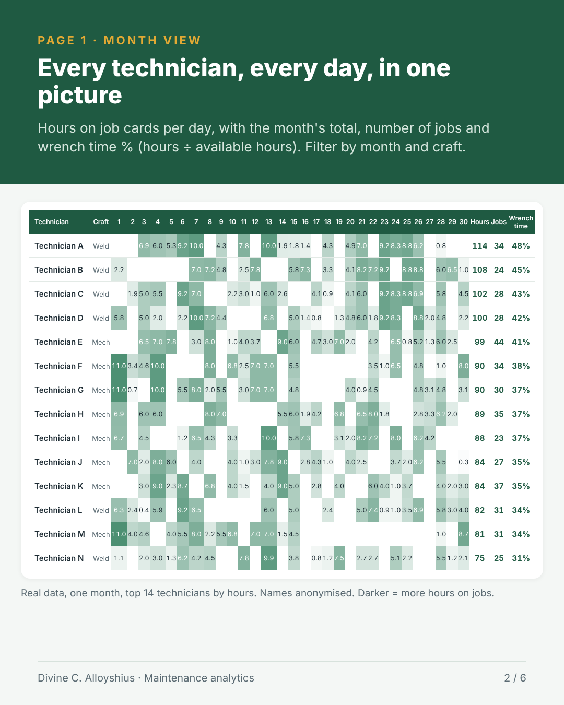
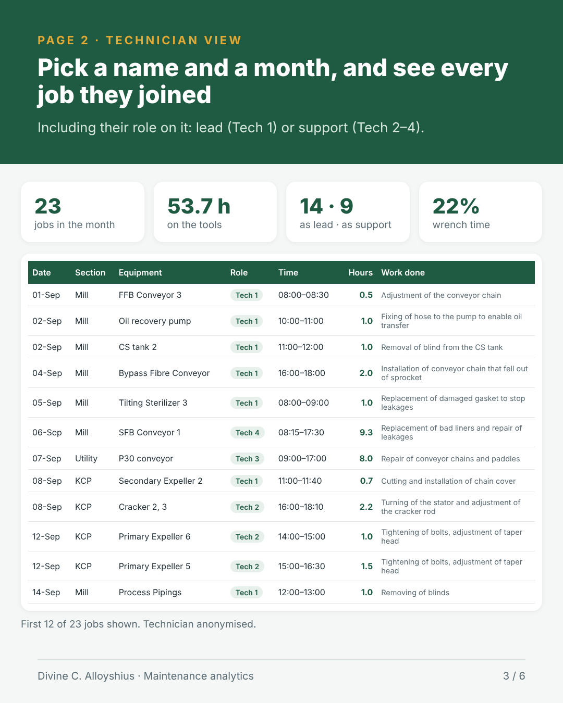
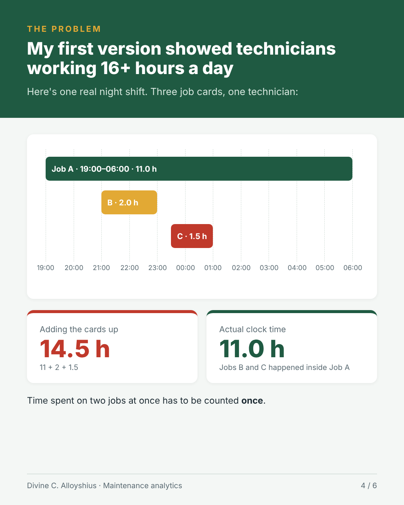
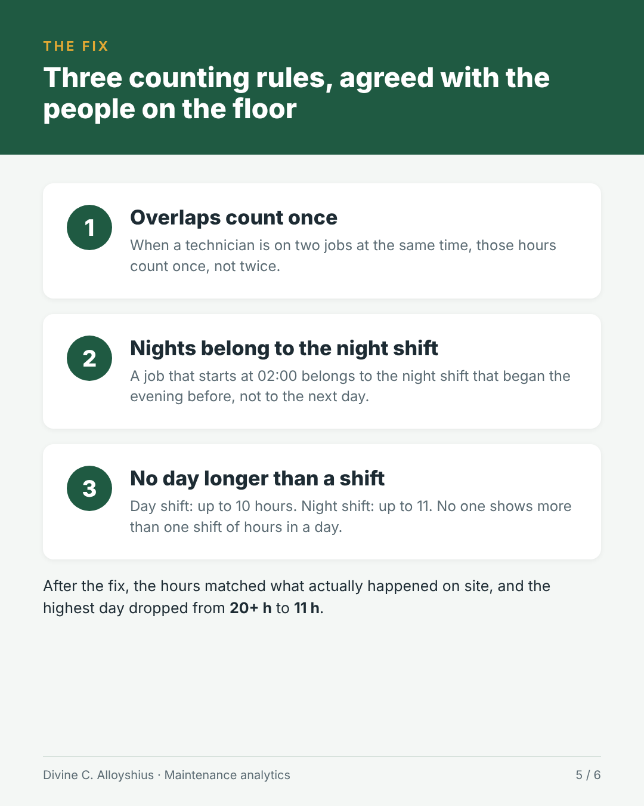

# Wrench Time Tracking (Maintenance Performance Dashboard)

**Author:** Divine C. Alloyshius
**Contact:** alloychimezie@gmail.com · +234 814 760 3384
**Category:** Maintenance Analytics · Workforce Productivity · Data Quality
**Tools:** Microsoft Excel 2019 (no VBA, no add-ins, no Excel 365 functions)
**Status:** Added to the Maintenance Performance Dashboard in November 2026.

*Month view with real data. Technician names are anonymised.*

## The business question

How much of a technician's shift is actually spent on jobs, and what fills the rest?

Job cards record who worked on what and when, but nobody could see it per technician without compiling it by hand. The maintenance manager wanted one place to look, inside the dashboard he already opens.

## What I built

Two new pages in the Maintenance Performance Dashboard, fed live from the seven section maintenance logs:

| Page | What it shows |
|---|---|
| **Wrench Time - Month** | Every technician × every day of the selected month: hours on jobs, number of jobs, available hours and wrench time %. Filter by month and craft. |
| **Wrench Time - Tech Jobs** | Pick a technician and a month: every job they joined, with their role (Tech 1 = lead, Tech 2–4 = support), start and finish times, job hours, counted hours and the work done. |

## The data problem I had to solve first

The first version showed some technicians working **16 to 20 hours in a day**, which is not possible on 10-hour day shifts and 11-hour night shifts. Digging into the job cards showed three causes:

1. **Overlapping job cards.** A technician on a 19:00–06:00 job was also on two shorter jobs inside the same window. Adding the cards gave 14.5 h; the real clock time was 11 h.
2. **Night shifts crossing midnight.** Jobs starting after midnight were landing on the next calendar day instead of the night shift they belonged to.
3. **No shift limit.** Nothing stopped one technician showing more than a shift's worth of hours in a day.

## The counting rules

- **Overlaps count once.** For each technician and shift, hours are clock time across all their jobs, so time on two jobs at once counts once. This is done in Excel 2019 with `MAXIFS`, crediting each job only with the time not already covered by an earlier-starting job.
- **Nights belong to the night shift.** A job is assigned to the shift it starts in (day 07:00–18:00, night 18:00–07:00). Work after midnight counts to the night that began the evening before.
- **Shift limits.** At most 10 h on a day shift and 11 h on a night shift, and never more than one shift's worth in a day. The limits and shift times are settings on the page.

## Result

- The highest technician-day dropped from **20+ h to 11 h**, and every figure now matches what happened on site.
- Results were checked against the raw logs for every technician and every day of a test month.
- The conversation moved from "are they busy?" to "what fills the time between jobs: waiting for spares, permits, travel?"

## Lesson

A dashboard is only as trusted as its definitions. Agreeing the counting rules with the people who do the work is what turns numbers people argue about into numbers people use.
