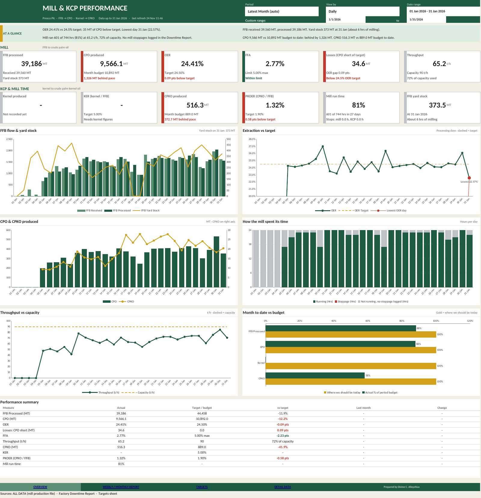
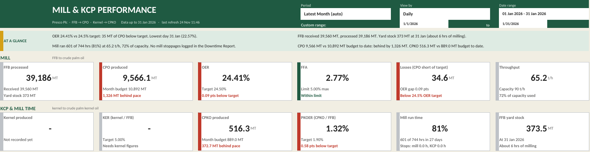

# Mill & KCP Performance Dashboard

**Author:** Divine C. Alloyshius
**Contact:** alloychimezie@gmail.com · +234 814 760 3384
**Category:** Production Analytics · Extraction Efficiency · Performance against Target and Budget
**Tools:** Microsoft Excel 2019 (no VBA, no add-ins, no dynamic arrays)
**Status:** Complete and in use. Part of the Factory Data and Reporting System.

## Overview

The mill turns fresh fruit bunches (FFB) into crude palm oil (CPO), and the kernel crushing plant (KCP) turns the kernels into crude palm kernel oil (CPKO). KCP is part of the mill, so this dashboard puts both on one page: what came in, what was processed, what was produced, how efficiently, and how that compares with target, budget and last month.

It replaces the first Mill Production Dashboard ([case study 2](02-milling-production.md)) with a fuller view built on the same structure as the Utility Dashboard: a one-page dashboard, a weekly, monthly and quarterly report, one data sheet and a targets sheet.

## The business problem

| Before | Impact |
|---|---|
| Production figures reported as totals | No quick view of how far OER was from target, or what that gap meant in tonnes of oil |
| No link between production and stoppages | Hard to tell whether low output came from slow processing or from hours lost |
| Budgets tracked separately | No daily answer to "are we on pace for the month?" |
| Mill and KCP reported apart | No single picture from fruit to both oils |

## The solution

**One page, two rows of KPI cards:**

- **Mill:** FFB processed, CPO produced, OER, FFA, losses (CPO short of target) and throughput against the 90 t/h capacity
- **KCP and mill time:** kernel produced, KER, CPKO produced, PKOER (CPKO ÷ FFB), mill run time and FFB yard stock

Each card shows the figure, its target or budget, and a coloured status stripe, so a problem stands out at a glance. An **At a glance** strip writes the key messages in plain sentences, for example: *"OER 24.41% vs 24.5% target: 35 MT of CPO below target. Lowest day 31 Jan (22.57%)."*

**Six wide charts:**

| Chart | Question it answers |
|---|---|
| FFB flow and yard stock | Are we processing what we receive, and how much fruit is waiting? |
| Extraction vs target | Which days fell below the OER target, and which was the lowest? |
| CPO and CPKO produced | How much of each oil, day by day? |
| How the mill spent its time | Running, stopped, or idle with no stoppage logged? |
| Throughput vs capacity | How hard is the mill working against its 90 t/h rating? |
| Month to date vs budget | Are we ahead or behind where we should be today? |

**Filters:** latest month (automatic), any month, or a custom date range, viewed daily, weekly or monthly.

**Performance summary table:** actual, target or budget, the gap, and the change against last month for every measure.

**Weekly and Monthly Report** sheet for meetings, a **Targets** sheet for the OER target, capacity, FFA limit and monthly budgets to 2030, and a hidden calculation layer that is locked so it cannot be broken by mistake.

## Linked to the rest of the system

- **Production data:** the ALL DATA sheet is linked to the mill production file, so the dashboard updates itself.
- **Factory Downtime Report:** mill and KCP stoppage hours are read from the downtime logs, so run time and stopped time come from the same record the whole factory uses.

## Challenges and how they were solved

| Challenge | Solution |
|---|---|
| "Losses" meant different things to different people | Defined clearly as the CPO short of the 24.5% OER target, in tonnes, so a small percentage gap becomes a figure everyone understands. |
| Excel 2019 has no dynamic arrays | Charts use named ranges that grow and shrink with the selected period, and summary figures use functions available in Excel 2019. |
| Kernel crushed is not yet recorded | The card says **"Not recorded yet"** instead of showing an estimate, so the dashboard never presents a guess as a fact. |
| Yard stock had no starting point | An opening stock and its date sit on the Targets sheet; yard stock then builds from fruit received minus fruit processed, and is also shown as hours of milling. |
| The first build looked unlike the other dashboards | Rebuilt on the Presco colour palette and the Utility Dashboard layout, with wide charts sized to fill the screen. |
| Data labels caused Excel to offer a file repair | Traced to three chart-file details and fixed, then checked in Excel itself before release. |
| Users could overwrite formulas | Every sheet is protected; only the period and view selectors stay open. |

## Results (January 2026 sample)

| What the dashboard showed | Why it matters |
|---|---|
| OER 24.41% against a 24.5% target | **About 35 MT of CPO** below target in one month, and the lowest day pinpointed |
| Mill ran 601 of 744 hours (81%) at 65.2 t/h | **72% of capacity**: where to look for lost hours and speed |
| Yard stock of 373 MT at month end | About 6 hours of milling waiting in the yard |
| CPO and CPKO against budget to date | Shows daily whether the month is on pace, not just at month end |
| FFA 2.77% against a 5% limit | Quality within limit, confirmed every day |

## Benefits and use cases

- **Mill management:** one page from fruit to both oils, against target and budget.
- **Production meetings:** the weekly and monthly report replaces manual compiling.
- **Supervisors:** daily view of throughput, run time and stoppages.
- **Management:** losses expressed in tonnes of oil, not just percentage points.

## Skills demonstrated

`Excel 2019` · `Production KPI design` · `Extraction rate analysis (OER, PKOER)` · `Budget tracking` · `Linked workbooks` · `Dashboard design` · `Data integrity and protection`
