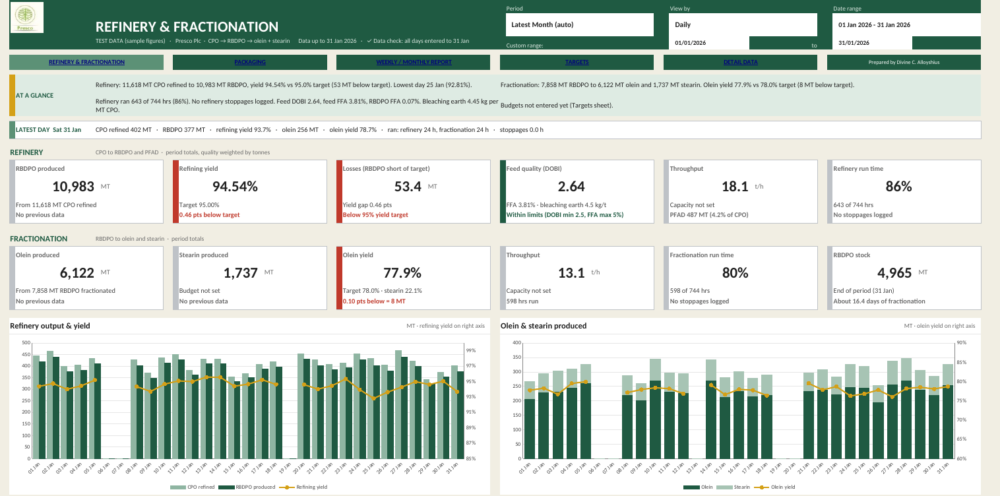
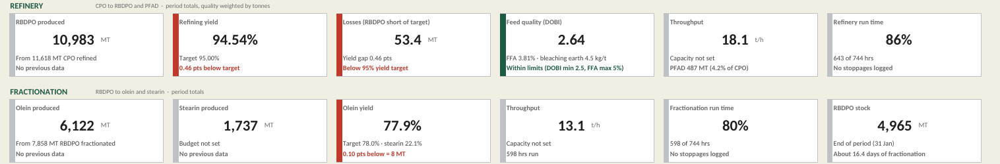
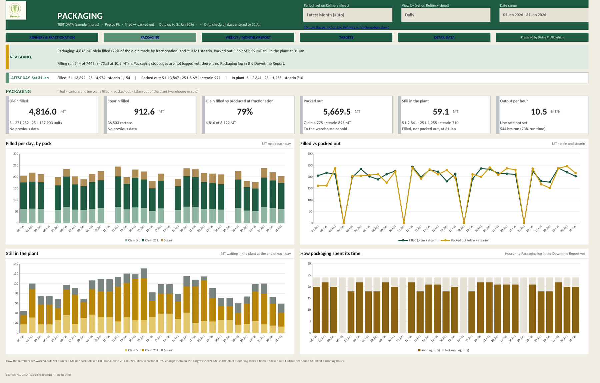

# Refinery, Fractionation & Packaging Performance Dashboard

**Author:** Divine C. Alloyshius
**Contact:** alloychimezie@gmail.com · +234 814 760 3384
**Category:** Production Analytics · Yield and Quality · Packaging
**Tools:** Microsoft Excel 2019 (no VBA, no add-ins, no dynamic arrays)
**Status:** Built and fully tested, ready for live data. The next step is connecting it to ABS as the single data source. Part of the Factory Data and Reporting System.

> **This is the updated version of the [Refinery Production Dashboard](01-refinery-production.md) (case study 1).** It keeps everything the first version did and records much more: fractionation in full, product quality, packaging in units, run time and stoppages from the factory downtime log, and a weekly and monthly report.

*Shown with test data (January 2026 sample figures).*

## Overview

The refinery turns crude palm oil (CPO) into refined oil (RBDPO) and fatty acid (PFAD). Fractionation then splits RBDPO into olein (liquid oil) and stearin, and packaging fills olein into 5 L packs and 25 L jerrycans and stearin into cartons. This dashboard follows the oil through all three steps on two pages, from the CPO refined to the packs leaving the plant.

## What's new compared with the first version

| First version (case study 1) | This version |
|---|---|
| 12 KPI cards on one page | **18 cards on two pages:** 6 refinery, 6 fractionation and 6 packaging, plus a latest-day strip on each page |
| 4 trend charts | **10 charts**, including quality trends (DOBI, FFA, RBDPO FFA, olein IV) and hours run against stoppages |
| Yield shown as a percentage | **Losses in tonnes:** the RBDPO short of the yield target, so a small gap becomes a figure everyone understands |
| No packaging | **Packaging in units and tonnes:** filled, packed out and still in the plant, by pack size |
| Downtime read from paper | **Stoppages linked** from the refinery and fractionation logs of the Factory Downtime Report |
| No written summary | **At a glance:** the key messages in plain sentences, plus a 12-measure performance summary against targets and last month |
| No check on missing days | **Data check** in the header: "all days entered", or which dates are missing |
| Report built by hand | **Weekly and Monthly Report** sheet, ready for meetings |

## The business problem

| Before | Impact |
|---|---|
| Refinery, fractionation and packaging were reported separately | No single picture of the oil from CPO to finished packs |
| Yield reported only as a percentage | A 0.46-point gap did not show how much oil it cost |
| Packaging counted in units only | No link between packs filled and the olein made by fractionation |
| No view of stock waiting in the packaging plant | Hard to see what was filled but not yet sent to the warehouse |
| Quality figures sat in lab sheets | Feed and product quality were not seen next to yield and output |

## The solution

**Refinery & Fractionation page**

- **At a glance** writes the main points in sentences, for example: *"Refinery: 11,618 MT CPO refined to 10,983 MT RBDPO, yield 94.54% vs 95.0% target (53 MT below target). Lowest day 25 Jan (92.81%)."*
- **Latest day strip:** what happened on the last day with data.
- **Refinery cards:** RBDPO produced, refining yield, losses (RBDPO short of target), feed quality (DOBI, FFA and bleaching earth per tonne), throughput and run time.
- **Fractionation cards:** olein and stearin produced, olein yield, throughput, run time, and RBDPO stock in days of fractionation.
- **Six charts:** refinery output and yield, olein and stearin produced, yields against target, hours run and stoppages, feed quality (DOBI and FFA) and product quality (RBDPO FFA and olein IV).
- **Performance summary:** actual, target, the gap and the change against last month for 12 measures.

**Packaging page**

- Packs are entered as units and converted to tonnes (olein 5 L = 0.00454 MT, 25 L = 0.0227 MT, stearin carton = 0.025 MT; the factors can be changed on the Targets sheet).
- **Cards:** olein filled, stearin filled, olein filled vs olein produced at fractionation, packed out, still in the plant, and output per hour.
- **Still in the plant** = opening stock + filled − packed out, shown by pack size.
- **Four charts:** filled per day by pack, filled vs packed out, stock still in the plant, and how packaging spent its time.

**Filters:** latest month (automatic), any month, or a custom date range, viewed daily, weekly or monthly. One set of selectors drives every page.

## Challenges and how they were solved

| Challenge | Solution |
|---|---|
| The first layout had an Overview page that repeated the other pages | Restructured into two clear pages, Refinery & Fractionation and Packaging, each reading from summary to detail. |
| The file is used by everyone, not only managers | Kept it simple: plain-language card titles, sentences in the At a glance strip, and only the cards each role needs. |
| The lab will get its own dashboard later | Quality is kept to trend charts and summary rows, not extra cards, so the two dashboards won't overlap. |
| Two stacked-bar charts on the packaging page looked alike | Gave "Still in the plant" its own gold and grey colours so it isn't confused with the packs-filled chart. |
| Some named ranges looked like cell addresses to Excel (for example "tR5") | Renamed them and added an automatic name check to every deep check, then rechecked the other dashboards. |
| A period with no rows showed a misleading data check | It now says "no data recorded for this period". |
| Charts dropped to zero on days that hadn't happened yet | Charts stop at the last day with data. |

## Testing

Every change was followed by a deep check: a full recalculation scanned for formula errors, plus seven test scenarios (full month, weekly view, custom range, missing days, empty file, a month with no data, and a chosen latest day). Each version was archived on the server before the new one was saved, and the saved copy was checked against the build.

## Results (January 2026 test data)

| What the dashboard showed | Why it matters |
|---|---|
| Refining yield 94.54% against a 95% target | **About 53 MT of RBDPO** below target in one month, with the lowest day pinpointed |
| Olein yield 77.9% against 78% | **8 MT of olein** below target |
| 4,816 MT of the 6,122 MT olein made was filled (79%) | Shows how much fractionation output goes to packaging |
| 59 MT still in the packaging plant at month end | Stock filled but not yet sent to the warehouse, by pack size |
| Feed DOBI 2.64 and FFA 3.81% | Feed quality within limits, confirmed every day |

## Benefits and use cases

- **Refinery management:** one view from CPO to finished packs, against target.
- **Supervisors and operators:** the latest-day strip and run time, every morning.
- **Packaging and stores:** packs filled, packed out and waiting in the plant.
- **Meetings:** the weekly and monthly report replaces manual compiling.

## Skills demonstrated

`Excel 2019` · `Production KPI design` · `Yield and loss analysis` · `Quality trend analysis (DOBI, FFA, IV)` · `Unit-to-tonnage conversion` · `Dashboard design for mixed audiences` · `Testing and version control` · `Data integrity and protection`
