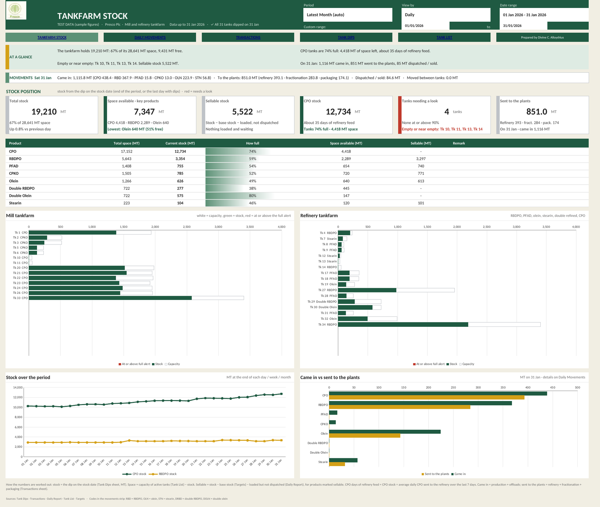
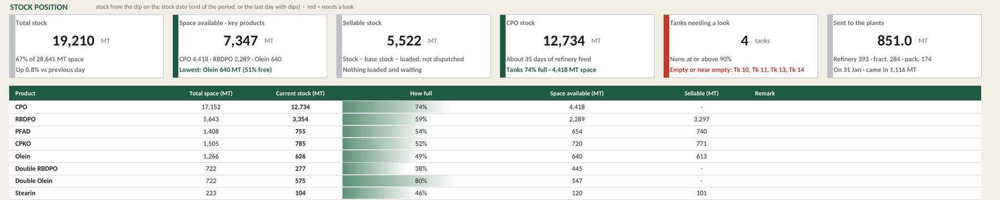
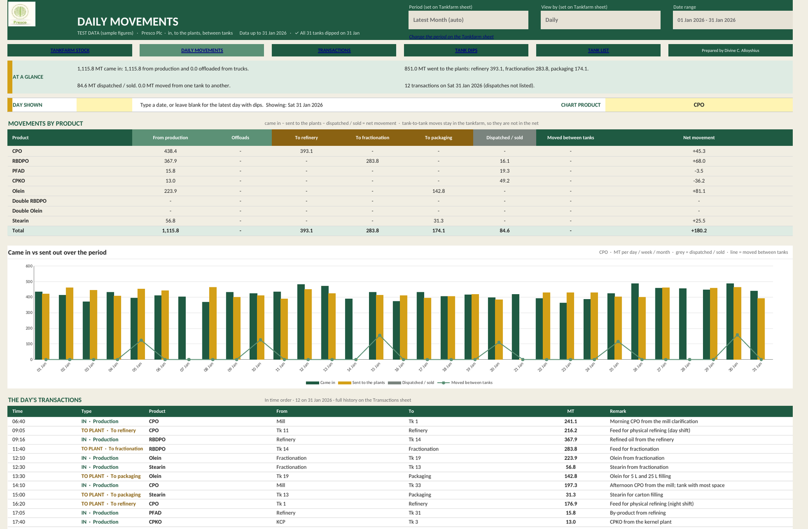

# Tankfarm Stock & Daily Movements Dashboard

**Author:** Divine C. Alloyshius
**Contact:** alloychimezie@gmail.com · +234 814 760 3384
**Category:** Inventory Analytics · Stock Accounting · Tank Management
**Tools:** Microsoft Excel 2019 (no VBA, no add-ins, no dynamic arrays)
**Status:** Built and fully tested, ready for live data. The next step is connecting it to ABS as the single data source. Part of the Factory Data and Reporting System.

> **This is the updated version of the [Tankfarm Stock Volume Dashboard](04-tankfarm-volumetric.md) (case study 4).** The first version showed how much was in each tank. This one also accounts for the oil: what came in, what went to the plants, what was dispatched, what can be sold, and how much room is left for the products that matter.

*Shown with test data (January 2026 sample figures).*

## Overview

The tankfarm stores every oil the factory makes and uses: CPO and CPKO from the mill, and RBDPO, PFAD, olein, stearin and double-refined products from the refinery. Oil comes in from production and truck offloads, goes out to the refinery, fractionation and packaging, moves between tanks, and is dispatched to customers. This dashboard keeps one account of all of it on two pages: **Tankfarm Stock** (where the oil is and how much room is left) and **Daily Movements** (what happened and why).

## What's new compared with the first version

| First version (case study 4) | This version |
|---|---|
| Two bar charts of stock by tank | **Two pages:** a stock position with 6 cards, a product table and 4 charts, and a daily movements page |
| Stock only | **Space, how full, sellable stock** and **days of refinery feed** for CPO |
| No record of movements | **Every movement logged:** production, offloads, transfers to the plants, tank-to-tank moves and dispatch, each with a remark saying why it happened |
| Mill and refinery lists repeated some tanks | **Each physical tank listed once** (31 tanks, 28,641 MT), on the side where its stock is recorded |
| A tank's product was fixed | **Product changes log:** when a tank is switched to another product, its capacity, stock and base stock move with it from that date |
| Empty tanks easy to miss | **Tanks needing a look:** tanks over the full alert, empty, or not dipped are named on a card |
| No written summary | **At a glance** in plain sentences, a movements strip by product, and a data check ("all 31 tanks dipped") |

## The business problem

| Before | Impact |
|---|---|
| Stock was a list of tank levels | No view of how much room was left for CPO, RBDPO and olein, the products that fill up fastest |
| Sellable stock was worked out by hand | Base stock (oil below the outlet) and loaded trucks waiting to leave were easy to forget |
| Movements were spread across several records | No single daily account of what came in, what went out, and why |
| Tanks sometimes change product | A fixed tank list gave the wrong product totals after a switch |
| The same tanks appeared on both the mill and refinery lists | Capacity was counted twice |

## The solution

**Tankfarm Stock page**

- **At a glance**, for example: *"The tankfarm holds 19,210 MT: 67% of its 28,641 MT space, 9,431 MT free."* and *"CPO tanks are 74% full: 4,418 MT of space left, about 35 days of refinery feed."*
- **Movements strip** for the day, by product: *"Came in: 1,115.8 MT (CPO 438.4 · RBD 367.9 · PFAD 15.8 · CPKO 13.0 · OLN 223.9 · STN 56.8)"*, plus what went to each plant, what was dispatched and what moved between tanks.
- **Six cards:**
  - total stock
  - space available for the key products (CPO, RBDPO and olein, chosen on the Targets sheet), with the tightest product named
  - sellable stock
  - CPO stock and days of refinery feed
  - tanks needing a look
  - oil sent to the plants
- **Product table:** space, stock, how full, space available, sellable and a remark for each of the 8 products.
- **Four charts:** mill tankfarm and refinery tankfarm (stock against capacity, red at the full alert), stock over the period, and came in vs sent to the plants by product.

**Daily Movements page**

- **Movements by product:** from production, offloads, to refinery, to fractionation, to packaging, dispatched / sold, moved between tanks, and the net movement.
- **Period chart** with a **product filter**, so each product tells its own story (for example CPO from the mill against CPO to the refinery).
- **The day's transactions** in time order, each with a remark saying why it happened. Any day can be picked.

**Input sheets:** Transactions, Tank Dips, Daily Report (loaded but not dispatched, remarks), Tank List with its product changes log, and Targets (alerts, sellable products, products in the space card, base stock per tank).

## How the key figures are worked out

- **Stock** = the dip on the stock date, in MT.
- **Space available** = capacity of active tanks − stock.
- **Sellable** = stock − base stock − loaded but not dispatched, for products marked sellable.
- **Days of refinery feed** = CPO stock ÷ average daily CPO sent to the refinery over the last 7 days (a setting on the Targets sheet).
- **Net movement** = came in − sent to the plants − dispatched. Tank-to-tank moves stay inside the tankfarm, so they are shown but not counted.

## Challenges and how they were solved

| Challenge | Solution |
|---|---|
| The mill and refinery tank lists repeated several tanks | Matched them against recorded stock and kept each tank once, on the side where its stock is recorded. Capacity now totals 28,641 MT with no double counting. |
| Tanks are sometimes switched to another product | A product changes log next to the tank list; a hidden sheet carries each tank's product forward day by day, so past dates keep the old product and later dates use the new one. |
| "Sellable" meant different things to different people | Defined it with the team: stock minus base stock per tank minus trucks loaded but not dispatched, and only for products that are sold from the tankfarm. |
| Adding every product together counted oil twice (CPO sent to the refinery comes back as RBDPO) | Added a product filter to the period chart, and labelled the all-products view as "handling, not oil gained". |
| Whole-tankfarm space hid a tight product | The space card shows only the key products, names the tightest one, and turns red when any of them reaches the full alert. |
| The deep check found two figures overwritten by the tank statistics | Moved them to their own rows and added an automatic check so it cannot happen again. |

## Testing

After every change: a full recalculation scanned for formula errors, and the build was run through test scenarios: a full month, missing dips, a chosen day, a weekly view, an empty file, a month with no data, loaded trucks, before and after a product switch, and the real tank list. Chart totals were checked against the raw transactions. Each version was archived on the server before the new one was saved, and the saved copy was checked against the build.

## Results (January 2026 test data)

| What the dashboard showed | Why it matters |
|---|---|
| 19,210 MT in stock, 67% of 28,641 MT | The whole tankfarm at a glance, with each tank counted once |
| 7,347 MT of space for CPO, RBDPO and olein; olein the tightest at 640 MT | Shows which product will run out of room first |
| CPO tanks 74% full, about 35 days of refinery feed | Links mill output, storage and refinery demand in one number |
| 5,522 MT sellable | What can be offered to customers today, net of base stock and loaded trucks |
| 4 tanks empty or near empty, named on the card | Idle tanks are seen the same day |

## Benefits and use cases

- **Management:** stock, space and sellable oil in one view.
- **Tankfarm team:** a single daily account of every movement, with reasons.
- **Logistics and sales:** sellable stock by product before committing to a dispatch.
- **Mill and refinery:** room left for their products, and days of feed for the refinery.

## Skills demonstrated

`Excel 2019` · `Inventory and stock accounting` · `Tank capacity management` · `Data model design (transactions, dips, product changes)` · `KPI definition with stakeholders` · `Dashboard design` · `Testing and version control`
